<!-- Tema "Ateliê das Estrelas" · perfil de annavrpedro16 -->
<!-- Toda a arte é original, pintada pincelada por pincelada em SVG: só o estilo e a paleta são inspirados no pós-impressionismo. -->

  

  

  
  
  
  <!-- Portfólio: por enquanto leva aos seus repositórios. Quando o site estiver pronto, troque o link abaixo pelo endereço dele. -->
  

 

  

A COLEÇÃO &nbsp;·&nbsp; TRÊS OBRAS PINTADAS PINCELADA POR PINCELADA

<h2 align="center"><i>Autorretrato</i></h2>

SOBRE MIM

> **Anna Vitória Rosa Pedro** · desenvolvedora 
> *Óleo sobre teclado, técnica mista: curiosidade, método e muitas linhas de código.*

Crio interfaces que unem **estética e clareza**: cada detalhe pensado como uma pincelada, cada componente como parte de uma composição maior.

- **Atualmente:** OnTrack
- **Estudando:** Engenharia da Computação no Inatel · membro da CP2eJr
- **Interesses:** Front-end · Mobile · Data Science · Data Analytics / BI · Machine Learning / IA · Marketing
- **Aberta a:** projetos criativos e open source

<h2 align="center"><i>A Paleta</i></h2>

FERRAMENTAS E TECNOLOGIAS

<!--
  COMO EDITAR A PALETA
  Cada tecnologia é uma linha .
  · Para remover: apague a linha inteira.
  · Para adicionar: copie uma linha e troque duas coisas:
      1. o nome que aparece no selo, logo depois de /badge/ (use %20 no lugar de espaço);
      2. o logo, depois de logo= (o nome do logo está em https://simpleicons.org).
  · Para criar uma categoria nova, copie um bloco inteiro (o  e o 
 de baixo).
-->

LINGUAGENS

  
  
  
  
  

FRONT-END E BACK-END

  
    
  
  
  
  

FERRAMENTAS

  
  
  
  

<!--
  PRONTAS PARA USAR: tire do comentário as que você usa (mova a linha para dentro de um bloco acima).
  
  
  
  
  
-->

LINGUAGENS MAIS USADAS NOS MEUS REPOSITÓRIOS

  

<h2 align="center"><i>Noite Estrelada de Commits</i></h2>

ESTATÍSTICAS

  

  

<h2 align="center"><i>Campo de Girassóis</i></h2>

CONTRIBUIÇÕES

  

  

  <i>“Quanto a mim, declaro que não sei nada sobre isso. Mas a visão das estrelas sempre me faz sonhar, da mesma maneira simples que me fazem sonhar os pontos pretos que representam cidades e vilarejos no mapa.”</i> 
  VINCENT VAN GOGH

